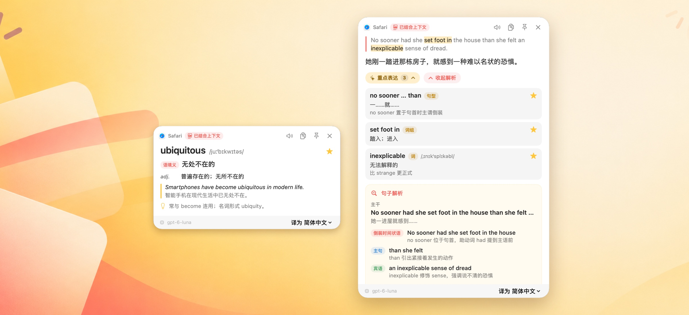
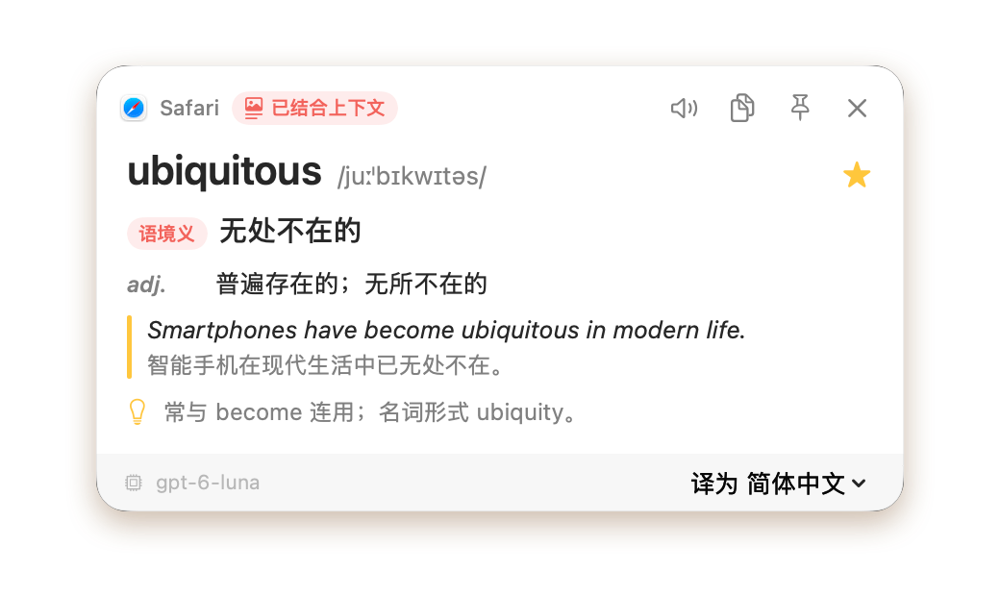
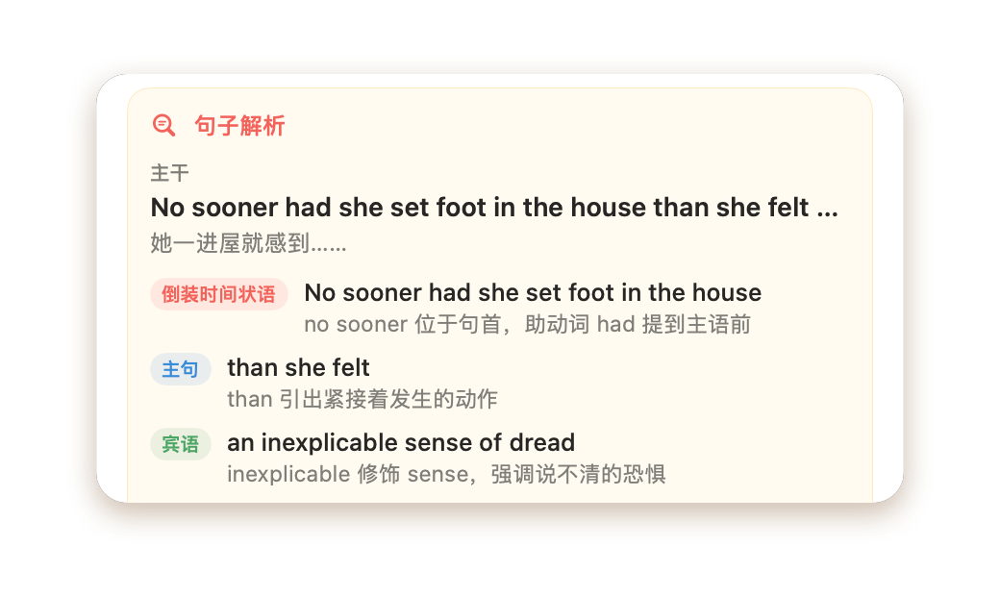
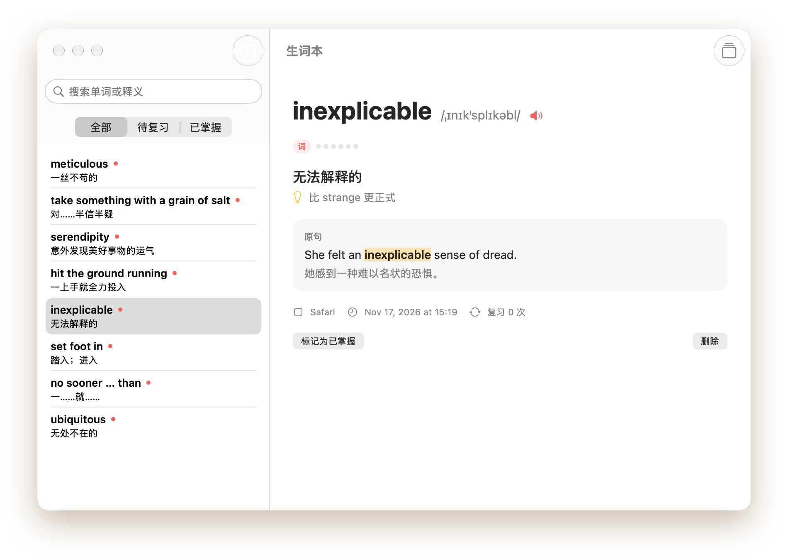

<div align="center">


# SwipeSay

**Select text, get a translation that knows its context, and keep the phrases worth learning.**

划词即译 · 结合上下文 · 顺手攒下值得学的表达

[](https://github.com/jiaqianjing/SwipeSay/releases/latest)


<br>



</div>

---

## Why SwipeSay

Most translators see only the words you selected. SwipeSay also reads **the paragraph around your selection**, so pronouns, polysemous words and terminology come out right. It then helps you **learn** from what you read without getting in the way.

<table>
<tr>
<td width="33%" valign="top">

### 🖱️ Translate anywhere
Select text in any app and press <kbd>⌥</kbd> <kbd>D</kbd>, or click the small coral button that appears by the cursor. <kbd>⌥</kbd> <kbd>S</kbd> translates a screen region with on-device OCR, and <kbd>⌥</kbd> <kbd>A</kbd> opens an input box.

</td>
<td width="33%" valign="top">

### 🧠 Context-aware
SwipeSay reads the surrounding paragraph through the Accessibility API, covering native text views, Safari/WebKit and Chromium. The model uses that context only to resolve ambiguity, so the translation stays close to what you selected.

</td>
<td width="33%" valign="top">

### ✦ Learn as you go
Expand the **重点表达** capsule to pull out the phrases, collocations and words worth learning. They are highlighted in the source and saved to your vocabulary book automatically.

</td>
</tr>
</table>

## A closer look

<table>
<tr>
<td width="50%" valign="top">

#### Word cards
Select a single word or a short phrase to get its meaning *in this context*, plus phonetics, senses, an example sentence and a usage tip.



</td>
<td width="50%" valign="top">

#### Sentence analysis, only when it's worth it
The capsule decides whether a sentence deserves analysis. Only genuinely complex sentences, or idiomatic everyday ones, get a **解析句子** button. Pressing it shows the sentence skeleton, chunks with their roles, key takeaways and a simpler paraphrase.



</td>
</tr>
</table>

#### Vocabulary book
Everything you look up or star is saved with its source sentence and app. You can search it, review it as flashcards with spaced repetition, and export it to CSV.



## Bring your own model

| Provider | Sign-in | Default model |
|---|---|---|
| **ChatGPT subscription** | Sign in with ChatGPT, or import `~/.codex/auth.json` | `gpt-6-luna` |
| **OpenAI** | API key | `gpt-6-luna` |
| **Anthropic** | API key | `claude-haiku-5-5` |
| **Google Gemini** | API key | `gemini-3.5-flash-lite` |
| **DeepSeek** | API key | `deepseek-flash` |
| **OpenAI-compatible** | Optional key | OpenRouter, Moonshot, Qwen, Zhipu, Ollama, LM Studio… |

The defaults are each provider's fast, inexpensive tier, because translation is short, high-volume work. You can pick any model in Settings → 模型服务. API keys are stored in the login Keychain.

## Install

1. Download the latest **[SwipeSay DMG](https://github.com/jiaqianjing/SwipeSay/releases/latest)** and drag SwipeSay into Applications.
2. On first launch, grant these in System Settings → Privacy & Security:
   - **Accessibility**, to read selections and their context. On macOS 27 it is listed as **Device Control and Data Access** (设备控制和数据访问).
   - **Screen Recording**, for screenshot translation. You may need to relaunch SwipeSay after granting it.
3. Choose a provider in Settings → 模型服务.

The app is signed with Developer ID and notarized by Apple. It is Universal (Apple silicon and Intel) and requires macOS 14 or later.

**Updates**: from 0.2.0 on, SwipeSay updates itself through [Sparkle](https://sparkle-project.org). It checks once a day. You can check by hand from the menu bar (检查更新…) or in Settings → 通用 → 更新, where you can also turn on automatic download. Updates are verified with an EdDSA signature on top of Apple's notarization, and your permissions, API keys and vocabulary carry over. Versions before 0.2.0 need to be replaced by hand once.

<details>
<summary><b>Accessibility is on but SwipeSay still says it's missing?</b></summary>

<br>

An approval left by an older build of the app is probably in the way. Reset it and grant access again:

```bash
tccutil reset Accessibility com.kenjia.swipesay
```

</details>

## Shortcuts

| Action | Default |
|---|---|
| Translate selection | <kbd>⌥</kbd> <kbd>D</kbd> |
| Translate screenshot | <kbd>⌥</kbd> <kbd>S</kbd> |
| Input box | <kbd>⌥</kbd> <kbd>A</kbd> |
| Close popup | <kbd>Esc</kbd> |

You can change any of them in Settings → 快捷键.

## Build from source

Requires Xcode 16+ and [XcodeGen](https://github.com/yonaskolb/XcodeGen).

```bash
xcodegen generate
open SwipeSay.xcodeproj
```

The Xcode project is generated from `project.yml`. Run `xcodegen generate` again after adding files.

<details>
<summary><b>Project layout</b></summary>

```
SwipeSay/
  App/AppDelegate.swift          hotkeys, actions, launch flow
  SwipeSayApp.swift              menu bar extra
  Core/
    Capture/                     AX selection + context, quick button, screenshot OCR
    Hotkey/                      Carbon global hotkeys, Shortcut model
    LLM/                         provider configs, Keychain, clients (OpenAI-compatible,
                                 Anthropic, Gemini, ChatGPT/Codex), ChatGPT OAuth
    Translation/                 prompts, response models, language/mode planning
    Vocabulary/                  SwiftData store (~/Library/Application Support/SwipeSay)
    Settings/                    AppSettings (UserDefaults)
  UI/
    Popup/                       floating panel, view model, capsule + analysis views
    Settings/  Vocabulary/  Components/
```

All prompts live in `Core/Translation/Prompts.swift`.

</details>

<details>
<summary><b>UI work without an API key (Debug builds)</b></summary>

<br>

```bash
SwipeSay.app/Contents/MacOS/SwipeSay -SwipeSayMock YES \
  -SwipeSayDemo "No sooner had she set foot in the house than she felt an inexplicable sense of dread." \
  -SwipeSayDemoExpand YES
```

| Flag | Effect |
|---|---|
| `-SwipeSayMock YES` | Canned responses and an in-memory vocabulary |
| `-SwipeSayDemo "text"` | Opens a popup for that text |
| `-SwipeSayDemoExpand YES` | Also opens the capsule and the analysis |
| `-SwipeSayDemoVocabulary YES` | Fills the in-memory vocabulary with sample entries |
| `-SwipeSayOpen <pane>` | Opens `general`, `providers`, `shortcuts`, `learning` or `vocabulary` |
| `-SwipeSayDemoSelect <term>` | Selects that entry in the vocabulary book |
| `-SwipeSayMockModel <name>` | Model name shown in the popup footer |
| `-SwipeSayAppearance light\|dark` | Forces the app's appearance |
| `-SwipeSayFlatBackground YES` | Solid backgrounds instead of the blur |
| `-SwipeSaySnapshot <prefix>` | Writes each visible window to `<prefix>-<n>.png`, then quits. This needs no Screen Recording permission |
| `-SwipeSayDemoBaseURL <url>` | Adds and selects an OpenAI-compatible provider at that URL, for example a local fake server |
| `-SwipeSayDemoRunTest YES` | Presses 测试连接 once the provider pane opens |

Mock mode never touches the keychain, and it keeps providers in memory, so your real settings are left alone. The screenshots in this README were made with these flags, using a background illustration generated by Codex.

</details>

<details>
<summary><b>Why there's no App Sandbox</b></summary>

<br>

Reading other apps' selections (`AXUIElement`), posting ⌘C as a fallback, and the localhost OAuth callback are not allowed in the sandbox. That is why SwipeSay ships outside the Mac App Store, as Bob and Easydict do. Hardened Runtime stays on.

</details>

<details>
<summary><b>Releasing (maintainers)</b></summary>

<br>

One command builds, signs, notarizes and publishes a release, then updates the Sparkle feed (`appcast.xml` on `main`):

```bash
NOTARY_PROFILE=<notarytool-profile> scripts/release.sh 0.2.1 --notes notes.md
```

- Run it from a clean `main` that is in sync with `origin/main`. It bumps the version in `project.yml`, adds one to the build number, archives a Universal build and exports it with Developer ID.
- It notarizes and staples both the app and the DMG, signs the DMG with the EdDSA key, creates the `vX.Y.Z` tag and GitHub Release, and publishes the appcast last.
- Add `--dry-run` to do everything except committing, tagging and publishing. Output goes to `build/release/`.
- The signing identity (team `UBS9FUBNFR`, bundle ID `com.kenjia.swipesay`) must never change. Otherwise users lose their permissions and keychain access after updating. The script checks this.

Prerequisites on the release machine:

- A Developer ID Application certificate in the login keychain.
- A notarytool profile: `xcrun notarytool store-credentials <name> --apple-id … --team-id UBS9FUBNFR`.
- The Sparkle EdDSA private key in the login keychain, alongside the signing certificate. It is Sparkle's default account (`ed25519`), shared by all of the maintainer's apps; the public key is in `SwipeSay/Info.plist`. On a new machine, import the backup with `generate_keys -f <backup-file>`. Keep the backup in a password manager and never commit it.

Stored data is versioned. `VocabularyStore.swift` explains how to add a schema version and a migration stage when a model changes.

</details>

## Notes

- The ChatGPT sign-in uses the Codex endpoints (`auth.openai.com` OAuth, `chatgpt.com/backend-api/codex/responses`). They are not a documented public API and may change.
- Requests use low reasoning effort where the provider supports it, to keep translations fast.
